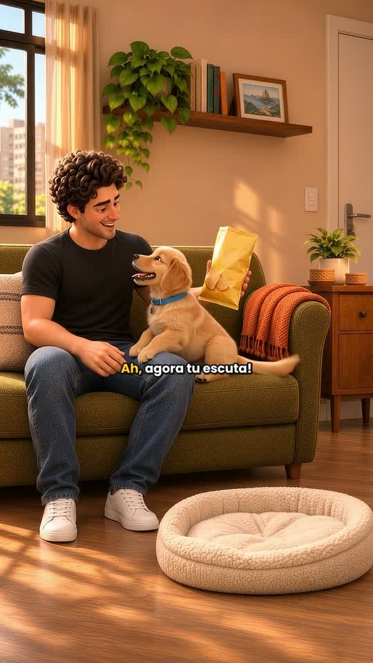

# Gabriel Luiz Liandro | Portfólio

Animação 3D com inteligência artificial, histórias do cotidiano e estudos publicitários autorais.

[Instagram](https://www.instagram.com/gabriel.videosiaofc/) · [Portfólio em PDF](portfolio/Portfolio-Gabriel-Luiz-Liandro.pdf)



## Projetos

### Nem começou e já quer férias
Vídeo autoral de 15,7 segundos: ligação de contratação, primeiro dia no escritório e a pergunta das férias. Três clipes, quatro gravações de voz sincronizadas, título branco e legendas, com ambiente ao fundo e sem música.

[Assistir ao vídeo mais recente](https://contatogabriel73-art.github.io/portfolio-gabriel-liandro/#emprego)


### Ah, agora tu escuta!
Vídeo autoral de aproximadamente 10 segundos sobre um cachorro que ignora o chamado, mas aparece ao ouvir um pacote. A ideia explora humor e identificação na convivência.

[Arquivo do vídeo](public/media/ju-chips.mp4)

### Já entendi.
Estudo publicitário autoral: Gabriel pega os óculos e Ju antecipa o passeio. O projeto reúne pesquisa visual, storyboard, animação e finalização com voz.

[Arquivo do vídeo](public/media/rayban-final.mp4) · [Storyboard](public/media/rayban-storyboard.png)

Estudo de portfólio sem contratação, patrocínio ou vínculo com Ray-Ban ou Meta.

## Executar o site localmente

Requer Node.js 22 ou superior.

```sh
npm ci
npm run build
npm run dev
```

Abra http://127.0.0.1:4173. A compilação estática fica em `dist/`.

## Estrutura

- `app/page.tsx`: textos, projetos e interações.
- `app/globals.css`: identidade visual e layout responsivo.
- `public/media/`: vídeos e imagens.
- `portfolio/`: PDF para apresentação profissional.
- `scripts/`: compilação e prévia local.

[Abrir o site público do portfólio](https://contatogabriel73-art.github.io/portfolio-gabriel-liandro/)

## Sites feitos com IA

### Moenda Café
Site conceito de cafeteria com abertura em "filme na rolagem": um vídeo gerado com IA, do grão à xícara, dividido em 190 quadros que avançam com a rolagem. Inclui história com números animados, cardápio em abas, origens em faixa horizontal, processo, depoimentos e visita. HTML, CSS e JavaScript.

Apresentação em motion design de 36 segundos, animada em HTML/CSS/JS com peças reais do site e trilha lo-fi original. Marca, endereço e preços fictícios.

[Ver apresentação no portfólio](https://contatogabriel73-art.github.io/portfolio-gabriel-liandro/#moenda) · [Arquivo do vídeo](public/media/moenda-apresentacao.mp4)

### VELO
Loja conceito de bicicletas: vitrine interativa com "ilha flutuante" gerada com IA, catálogo de 19 produtos com busca e filtros, comparação de até três bikes, página de produto com cor, tamanho e entrega, e sacola salva no navegador. HTML, CSS e JavaScript.

Apresentação em motion design de 39 segundos, animada em HTML/CSS/JS com peças reais do site e trilha instrumental original. Marca e preços fictícios; sem pagamento ou pedidos reais.

[Ver apresentação no portfólio](https://contatogabriel73-art.github.io/portfolio-gabriel-liandro/#velo) · [Arquivo do vídeo](public/media/velo-apresentacao.mp4)

### Brasa & Espeto
Site demonstrativo de restaurante com identidade vinho e creme, cardápio interativo e movimentos de rolagem. React, Tailwind CSS e GSAP/ScrollTrigger.

A apresentação foi capturada do site local, acelerada em 1,7× e finalizada com trilha instrumental original. Duração aproximada: 40 segundos. Dados fictícios e reserva simulada; sem backend de reservas nesta versão.

[Ver apresentação no portfólio](https://contatogabriel73-art.github.io/portfolio-gabriel-liandro/#sites-ia) · [Arquivo do vídeo](public/media/brasa-espeto-apresentacao.mp4)

## Publicação no GitHub Pages

O site público é servido a partir de `docs/`. Depois de editar o código, execute `npm run build:pages` e envie as alterações de `docs/` junto com o código. Os caminhos de imagens e vídeos são ajustados para o endereço do projeto. O site é estático e não utiliza banco de dados.
